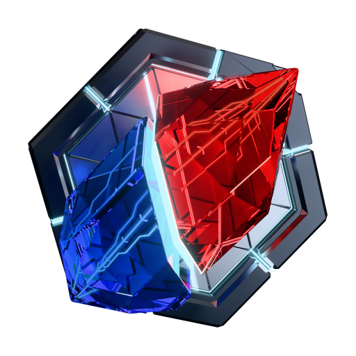
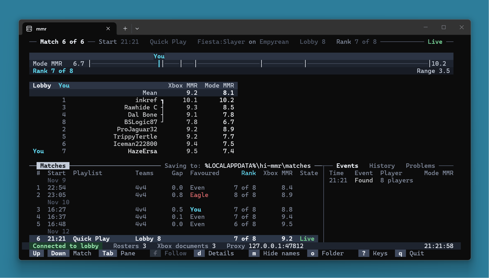
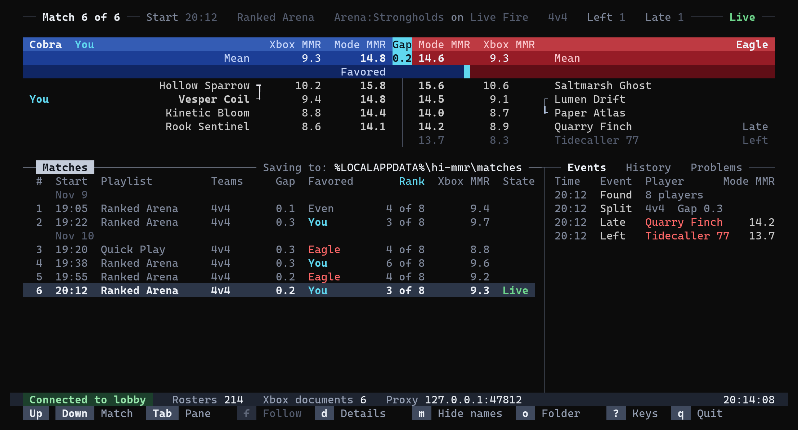
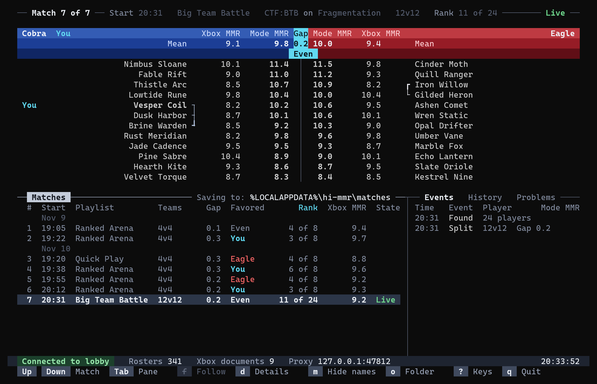
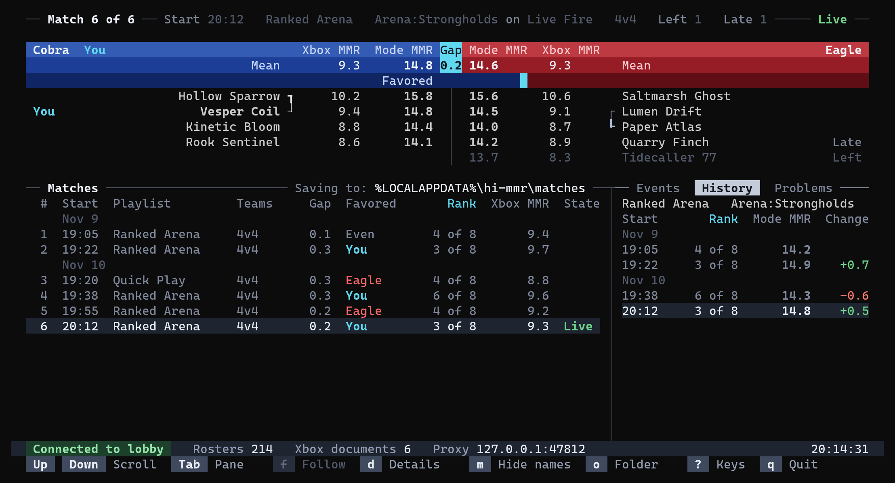

<p align="center">
  
</p>

<h1 align="center"><code>mmr</code><br></h1>

<p align="center">Hidden MMR and team balance for Halo Infinite.</p>

<p align="center">
  <a href="https://github.com/OpenSpartan/mmr/actions/workflows/ci.yml"></a>
  <a href="LICENSE"></a>
  
</p>

`mmr` reads the hidden player MMR out of the Halo Infinite API data stream. This allows you to estimate your assessed in-game performance locally.

>[!WARNING]
>This is an experimental hobby project. Use it at your own risk. I am still figuring out what these ratings actually are, so take both their precision and my guesses about how the game uses them with a grain of salt. This project is not supported or otherwise endorsed by either Halo Studios or Microsoft.



## Getting Started

### Installer

1. Download the setup from the [available releases](https://github.com/OpenSpartan/mmr/releases).
2. Run the installer.
3. To update later, run a newer setup.

### Portable

1. Download the `.zip` from the [available releases](https://github.com/OpenSpartan/mmr/releases) and extract it to a folder.
2. Open a terminal in that folder and run `.\mmr.exe cert new`.
3. Double-click `mmr.exe` to start it, or use `.\mmr.exe` wherever you see `mmr` in the commands below.
4. Before you delete the folder, run `.\mmr.exe cert remove`.

## Usage

### Set up the certificate

`mmr` sees the lobby data by running a proxy on your PC. To do that, it needs a certificate that Windows trusts, similar to how tools like Fiddler or mitmproxy work. If you didn't let the setup do it for you, run this once to generate and install a new certificate:

```powershell
mmr cert new
```

>[!NOTE]
>The certificate is generated only for this computer, and it does not allow reading any other traffic or data. It's a test certificate that is used for experimentation only, and you can remove it at any point with `mmr cert remove`.

>[!NOTE]
>`mmr` does not tamper or otherwise interfere with game data. It only reads API responses.

### Watch a match

Start `mmr` from the Start menu, or run:

```powershell
mmr watch
```

You need to do this **before you start Halo Infinite**. `mmr` has to be running by the time the game connects to a lobby, and the easiest way to make sure of that is to start it first.

Every match gets saved to `%LOCALAPPDATA%\hi-mmr\matches`.

>[!WARNING]
>While `mmr` is running, it takes over your Windows proxy settings. That means that anything else that relies on a proxy of its own (think a VPN app, or Fiddler) might not be able to connect until you quit `mmr`. Your settings are put back when it quits. If it didn't get the chance to do that (it crashed, you ended it from Task Manager, or it was still running when you signed out or shut down), the settings are put back the next time it starts.

There are a few options that you can pass to `watch`:

| Option          | Description                                                                          |
|:----------------|:-------------------------------------------------------------------------------------|
| `--mask`        | Show players as letters instead of their gamertags.                                  |
| `--plain`       | Print one line per change instead of opening the full-screen view.                   |
| `--no-save`     | Don't save matches.                                                                  |
| `--store <dir>` | Keep the matches and the certificate in a different folder.                          |
| `--port <n>`    | Use a different proxy port. The default is `47812`.                                  |
| `--game <dir>`  | Point to the game folder, if it's not in one of the default Steam or Xbox app spots. |

## Reading the Screen

The live view puts the teams side by side, with the players on each team ordered by their Mode MMR. Under that you get the list of matches, along with the Events, History, and Problems views.



Players that are in the same party share a bracket, and the heavier segment of the bracket marks the party leader:



### Ratings

There are two ratings on the screen - **Mode MMR** and **Xbox MMR**. They are _not_ the same thing, and neither one of them is the CSR that you see in Ranked playlists. Mode MMR also uses a different scale for every mode, so it only makes sense to compare it within the same playlist and mode.

| Metric   | Description                                                                                                                   |
|:---------|:------------------------------------------------------------------------------------------------------------------------------|
| Mode MMR | The rating that the lobby service has for the playlist and mode.                                                              |
| Xbox MMR | The rating that the matchmaker puts in the Xbox session document. This one you can compare across matches.                    |
| Mean     | Average Mode MMR of the rated players that are still on the team.                                                             |
| Gap      | The highest team mean minus the lowest team mean.                                                                             |
| Favored  | The team that the gap favors, given how spread out the Mode MMR is. `Even` if the gap is small, `Strongly favored` if it's large. |
| Rank     | Where you land in the match if everyone is ordered by Mode MMR.                                                               |
| Change   | In History, how much your Mode MMR changed since the previous match.                                                          |

The History view tracks your Mode MMR for the playlist and mode of whatever match you have selected:



### Key bindings

| Key                        | Action                                                                       |
|:---------------------------|:-----------------------------------------------------------------------------|
| `Tab` `Shift+Tab`          | Move to the next or previous pane.                                           |
| `Up` `Down`                | Choose a match, or scroll the active pane.                                   |
| `PgUp` `PgDn` `Home` `End` | Page up or down, or jump to the top or bottom.                               |
| `f`                        | Follow the newest match.                                                     |
| `d`                        | Show every player and value in one table.                                    |
| `e` `h` `p`                | Open Events, History, or Problems.                                           |
| `m`                        | Toggle name masking.                                                         |
| `o`                        | Open the folder with the saved matches.                                      |
| `?`                        | Show all key bindings.                                                       |
| `Esc`                      | Go back.                                                                     |
| `q`                        | Quit. You'll need to press it twice if the game is still connected.          |

## Other Commands

You can always run `mmr help` to see every command along with its options.

### `history`

Prints the ratings from your saved matches, with one table for every playlist and mode. If you only care about one player, pass their XUID.

```powershell
mmr history [<xuid>]
```

### `read`

Reads a Fiddler capture (`.saz`) and prints one table per match. With `--json`, the matches are written to a file, and with `--save` they are added to your saved matches.

```powershell
mmr read capture.saz [--json out.json] [--save]
```

>[!WARNING]
>Never share a Fiddler capture (the `.saz` file) with anyone. It may have your sign-in tokens in it that might still be active.

Both `history` and `read` also accept `--mask` and `--store <dir>`.

### `cert`

Manages the certificate that the proxy uses. The certificate is good for a year.

```powershell
mmr cert           # Show whether the certificate is trusted, and when it expires
mmr cert new       # Make a new certificate and trust it
mmr cert remove    # Remove it from Windows and delete its files
```

## Building

You will need Windows and [Rust](https://rustup.rs). Rust on Windows also needs the Visual Studio C++ build tools - the Rust installer will offer to set those up for you. The Rust version is pinned in [`rust-toolchain.toml`](rust-toolchain.toml), and it gets installed automatically on the first build.

```powershell
git clone https://github.com/OpenSpartan/mmr
cd mmr
cargo build --release
```

Once that's done, you'll find the binary in `target\release\mmr.exe`. To run the tests:

```powershell
cargo test --release
```

One of the tests needs a Fiddler capture of your own, so it's ignored by default. If you have one, you can run it like this:

```powershell
$env:MMR_TEST_SAZ = "capture.saz"
cargo test --release -- --ignored
```

### Installer

To build the setup, install [Inno Setup 7](https://jrsoftware.org/isinfo.php) and run its compiler from the repository folder. The setup ends up in `target\installer`.

```powershell
ISCC /DAppVersion=0.0.1 installer\mmr.iss
```

Pushing a tag like `0.2.0` builds both the setup and the zip in CI, and publishes a release with the two attached. The tag is the version - there is nothing to bump in `Cargo.toml`.

## FAQ

### Is this in any way endorsed by Halo Studios or Microsoft?

No. Not at all. This project is not funded, supported, or otherwise endorsed by either Halo Studios or Microsoft.

### Does this work on Xbox, or on anything other than Windows?

Nope. It only works on Windows, and only for the game running on the same PC.

### Can I see the ratings for a match I'm not in?

No. `mmr` only sees what the game sends to your PC, and that's just the lobbies that you are in.

### I started `mmr` and my match shows up under `unknown`. What's up with that?

`mmr` has to be running before the game connects to a lobby. If the connection was opened earlier, its rosters get filed under `unknown`. Start `mmr` before you start the game and you won't run into this.

### Why do some players show up as a number instead of a gamertag?

That number is their XUID. Xbox only learns a player's gamertag once they accept the match, so if someone accepted late or joined mid-match, there might not be a gamertag for them - unless another one of your matches already named them.

### Something is broken. What do I do?

[Open an issue](https://github.com/OpenSpartan/mmr/issues) so that I can investigate.

## Privacy

`mmr` is exclusively a local data analysis tool. It does not collect, distribute, or otherwise make any data available outside of your own computer. There is no telemetry, and no information is being passed to me or anyone else - everything it reads and saves stays on your PC.

It also does not interpret, store, or otherwise use any of the credentials that are on the wire, or anything around them. The only things that are saved locally for your analysis are the decoded match facts (players, teams, and ratings).

Besides the network traffic, `mmr` reads a few things from disk:

| What                                                                 | Why                                                                                              |
|:---------------------------------------------------------------------|:-------------------------------------------------------------------------------------------------|
| The game's web cache (`disk_cache\webcache` in the game folder)      | To show the names of playlists, modes, and maps. The lobby data only has their IDs.              |
| Steam's `libraryfolders.vdf`                                         | To find the folder where the game is installed.                                                  |
| Its own folder (`%LOCALAPPDATA%\hi-mmr`, or whatever `--store` says) | To load your saved matches, the certificate, and the backup of your Windows proxy settings.      |
| A Fiddler capture (`.saz`)                                           | Only when you pass one to `mmr read` yourself.                                                   |

The game's files, Steam's files, and your captures are only ever read. The only files that `mmr` writes are the ones in its own folder, and the `--json` file if you ask for one.

## License

MIT. See [LICENSE](LICENSE).
